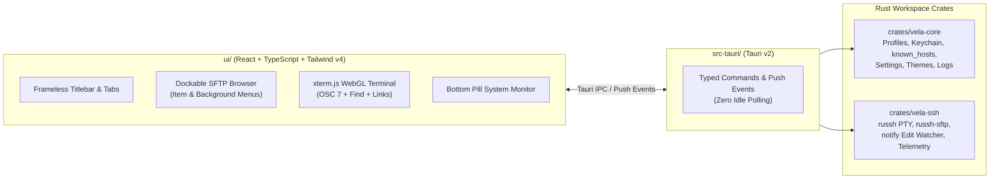

<div align="center">

<h1>Vela</h1>

<p>
  <strong>A fast, open-source desktop SSH and SFTP client built with Rust, Tauri v2, React, and xterm.js WebGL.</strong>
</p>

<p>
  <a href="https://github.com/aboveproof/Vela/blob/main/LICENSE">
    
  </a>
  
  
  
</p>

<p>
  <a href="#features">Features</a> ·
  <a href="#architecture">Architecture</a> ·
  <a href="#getting-started">Getting Started</a> ·
  <a href="#keyboard-shortcuts">Shortcuts</a> ·
  <a href="#roadmap">Roadmap</a>
</p>

</div>

---

Vela pairs a Rust SSH and SFTP engine (`russh` + `russh-sftp`) with a Tauri v2 desktop shell and an `xterm.js` terminal. Browse files beside a session, keep several hosts open, and watch host activity without leaving the window.

<h2 id="features">Features</h2>

<table>
  <tr>
    <td width="50%" valign="top">
      <h3>SSH &amp; Terminal</h3>
      <ul>
        <li><strong>Pure-Rust transport:</strong> Async SSH multiplexing over <code>russh</code> with zero OpenSSL or libssh2 C dependencies.</li>
        <li><strong>WebGL terminal:</strong> <code>xterm.js</code> with WebGL glyph atlases handles <code>btop</code>, <code>htop</code>, <code>tmux</code>, and <code>nvim</code> at high frame rates.</li>
        <li><strong>TOFU host verification:</strong> Checks SHA-256 server fingerprints against <code>known_hosts</code> and warns on key changes.</li>
        <li><strong>OS keychain storage:</strong> Passwords and key passphrases stay in Windows Credential Manager, macOS Keychain, or Linux Secret Service.</li>
        <li><strong>Terminal context menu:</strong> Copy, Copy All, Paste, Find (<code>Ctrl+Shift+F</code>), font scaling, clear scrollback, reset, and save transcript to file.</li>
      </ul>
    </td>
    <td width="50%" valign="top">
      <h3>SFTP Browser &amp; Host Monitor</h3>
      <ul>
        <li><strong>Dockable SFTP sidebar:</strong> Dock the browser to the left, right, top, or bottom edge and resize it by dragging.</li>
        <li><strong>Follows terminal <code>cd</code>:</strong> Parses OSC 7 sequences to keep the SFTP directory in sync with your shell.</li>
        <li><strong>Edit remote files in local apps:</strong> Double-click any remote file to open it in your default editor; Vela watches for saves and uploads changes back over SFTP.</li>
        <li><strong>Full file operations:</strong> Drag-and-drop uploads, file picker uploads, downloads, rename, new directory, new empty file, recursive delete, and visual <code>chmod</code> checkboxes + octal input.</li>
        <li><strong>Live host telemetry:</strong> Rounded bottom pills show hostname, real <code>/proc/stat</code> CPU % with a sparkline, RAM usage, network TX/RX Mb/s, uptime, active users, and mounted disks.</li>
      </ul>
    </td>
  </tr>
</table>

<h2 id="architecture">Architecture</h2>



### Engineering Standards

- **Strict Rust linting:** Workspace lints forbid unsafe code and deny `unwrap`, `expect`, and explicit `panic` in Clippy checks.
- **Atomic config writes:** Saved hosts (`hosts.toml`), settings (`settings.toml`), and `known_hosts` write to a sibling `.tmp` file before renaming.
- **Event-driven IPC:** Tokio tasks push PTY chunks and connection events to the frontend. The host monitor samples system activity while connected.
- **Rotating diagnostics:** Structured `tracing` logs rotate daily in the OS local data directory.

<h2 id="getting-started">Getting Started</h2>

### Prerequisites

- **Rust** (stable, edition 2024) and `cargo`
- **Node.js** 20+ and `npm`
- **Windows:** WebView2 Runtime (preinstalled on Windows 10/11)
- **Linux:** `webkit2gtk`, `libgtk-3-dev`, `libayatana-appindicator3-dev`
- **macOS:** Xcode Command Line Tools

### Build &amp; Run

```bash
git clone https://github.com/aboveproof/Vela.git
cd Vela

# 1. Install and bundle the React + xterm.js frontend
cd ui
npm install
npm run build
cd ..

# 2. Run Vela (use --release for peak performance)
cargo run --release -p vela
```

### Run Checks &amp; Tests

```bash
cargo clippy --workspace --all-targets -- -D warnings
cargo test --workspace
cd ui && npm ci && npm run build
```

<details>
<summary><strong>Windows MinGW note (paths containing <code>&amp;</code>)</strong></summary>
<br />
GNU <code>windres</code> fails if the Cargo target directory path contains an ampersand (<code>&amp;</code>). Clone Vela into a path without <code>&amp;</code>, or set <code>CARGO_TARGET_DIR</code> to a clean directory before building.
</details>

<h2 id="keyboard-shortcuts">Keyboard Shortcuts &amp; Mouse Actions</h2>

| Input | Action |
| :--- | :--- |
| `Ctrl + K` / `Ctrl + Shift + P` | Open Command Palette (connect hosts, run snippets, split, switch themes) |
| `Ctrl + B` | Toggle sidebar |
| `Ctrl + Shift + C` | Copy selected terminal text |
| `Ctrl + Shift + V` / `Shift + Insert` | Paste clipboard into active terminal (bracketed paste) |
| `Ctrl + Shift + F` | Open terminal Find bar |
| `Ctrl + Shift + S` | Save terminal output to a file |
| `Middle-click` on SFTP item | Insert shell-quoted remote path into terminal |
| `Double-click` on SFTP item | Open folder or edit file in local editor (re-uploads on save) |
| `Right-click` on SFTP item / blank area / terminal | Context menus for file ops, Quick Preview, `cd`, sidebar dock position, and terminal actions |
| `Drag & drop` files or folders onto window | Upload files or folders recursively to the current remote SFTP folder |

<h2 id="roadmap">Roadmap</h2>

- [x] Pure-Rust SSH + PTY + multiplexed SFTP engine (`russh` / `russh-sftp`)
- [x] Dockable SFTP browser with full file ops, pinned bookmarks, instant filter, quick inline preview, recursive drag-and-drop, and local-edit auto-upload
- [x] `xterm.js` WebGL terminal with OSC 7 folder tracking, Find bar, bracketed paste, and context menu
- [x] Live host monitoring strip (CPU sparkline, RAM, network TX/RX, uptime, users, disks)
- [x] `Ctrl+K` Command Palette, side-by-side Split View, and multi-tab Broadcast Input
- [x] Saved Command Snippets with 1-click run and broadcast execution
- [x] Local Port Forwarding (`-L`) SSH Tunnel Manager with live connection counts
- [x] `~/.ssh/config` importer and built-in Ed25519 SSH Key Manager with 1-click `ssh-copy-id`
- [x] OS keychain credentials, TOFU `known_hosts`, custom fonts, and themes
- [ ] Remote (`-R`) and Dynamic SOCKS5 (`-D`) tunnels + `ProxyJump` bastion chaining
- [ ] Encrypted `.vela-vault` backup/sync export (Argon2id + ChaCha20-Poly1305)

## License

licensed under [MIT](LICENSE).
